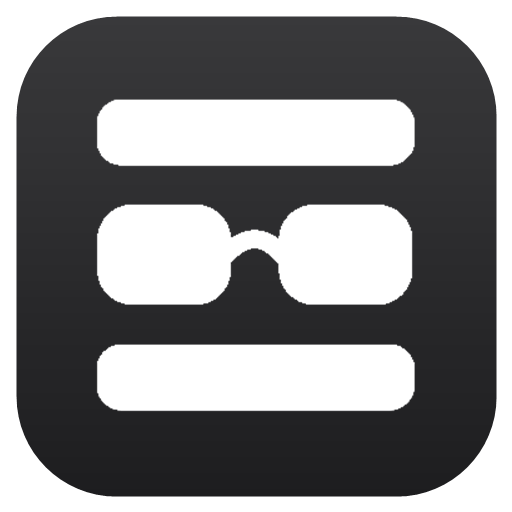
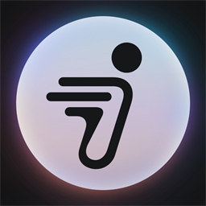

# Some Loon Things

自用 Loon / Mihomo 插件、规则和跨平台脚本仓库，支持一键导入与参数化配置。

---

## 🚀 插件一键导入 (Loon Plugins)

| 插件名称 | 说明 | 一键导入 | 直链 / 源码 |
| :--- | :--- | :---: | :---: |
| **9bot** | 9bot 自动签到与 Cookie 捕获，支持自定义时间与独立开关 | [导入 Loon](https://www.nsloon.com/openloon/import?plugin=https://raw.githubusercontent.com/fishyo/someLoonThings/main/plugin/ninebot.plugin) | [查看](https://raw.githubusercontent.com/fishyo/someLoonThings/main/plugin/ninebot.plugin) |
| **搬瓦工状态** | BandwagonHost VPS 流量与运行状态定时查询，免 BoxJS 直接在 UI 配置 | [导入 Loon](https://www.nsloon.com/openloon/import?plugin=https://raw.githubusercontent.com/fishyo/someLoonThings/main/plugin/bandwagon.plugin) | [查看](https://raw.githubusercontent.com/fishyo/someLoonThings/main/plugin/bandwagon.plugin) |
| **RackNerd状态** | RackNerd VPS 流量、内存与运行状态定时查询，免 BoxJS 直接在 UI 配置 | [导入 Loon](https://www.nsloon.com/openloon/import?plugin=https://raw.githubusercontent.com/fishyo/someLoonThings/main/plugin/racknerd.plugin) | [查看](https://raw.githubusercontent.com/fishyo/someLoonThings/main/plugin/racknerd.plugin) |
| **自用拦截** | 广告拦截与 Header 重写（少数派、华尔街见闻、京东开屏等） | [导入 Loon](https://www.nsloon.com/openloon/import?plugin=https://raw.githubusercontent.com/fishyo/someLoonThings/main/plugin/ad-block.lpx) | [查看](https://raw.githubusercontent.com/fishyo/someLoonThings/main/plugin/ad-block.lpx) |

---

## 🌐 分流规则集 (Rule-Sets)

| 规则名称 | 平台 | 说明 | 一键导入 / 链接 |
| :--- | :---: | :--- | :---: |
| **AI 服务分流** | Loon | 聚合全网主流 AI 服务（Gemini, OpenAI, Claude, Grok 等） | [导入 Loon](https://www.nsloon.com/openloon/import?rules=https://raw.githubusercontent.com/fishyo/someLoonThings/main/loon/ai.lsr) / [查看](https://raw.githubusercontent.com/fishyo/someLoonThings/main/loon/ai.lsr) |
| **Supercell 直连** | Loon | 皇室战争、荒野乱斗等官方直连域名列表 | [导入 Loon](https://www.nsloon.com/openloon/import?rules=https://raw.githubusercontent.com/fishyo/someLoonThings/main/loon/supercell.lsr) / [查看](https://raw.githubusercontent.com/fishyo/someLoonThings/main/loon/supercell.lsr) |
| **自用代理域名** | Loon | 个人常用代理域名集合（Cloudflare, Bitwarden 等） | [导入 Loon](https://www.nsloon.com/openloon/import?rules=https://raw.githubusercontent.com/fishyo/someLoonThings/main/loon/proxy.lsr) / [查看](https://raw.githubusercontent.com/fishyo/someLoonThings/main/loon/proxy.lsr) |
| **AI 服务分流** | Mihomo | Clash / Mihomo 兼容规则集 (`rule-providers`) | [查看](https://raw.githubusercontent.com/fishyo/someLoonThings/main/mihomo/ai.yaml) |
| **Supercell 直连** | Mihomo | Clash / Mihomo 兼容规则集 (`rule-providers`) | [查看](https://raw.githubusercontent.com/fishyo/someLoonThings/main/mihomo/direct.yaml) |
| **自用代理规则** | Mihomo | Clash / Mihomo 兼容规则集 (`rule-providers`) | [查看](https://raw.githubusercontent.com/fishyo/someLoonThings/main/mihomo/proxy.yaml) |

---

## 📋 插件详细特性

### 1. 🛵 9bot (`ninebot.plugin`)
- **双开关控制**：
  - `启用签到`：可随时一键关闭自动签到，不弹窗不打扰；
  - `获取Cookie`：捕获成功后关闭，Cookie 失效时一键打开，进入 App 自动抓取更新。
- **自定义时间**：支持在 Loon 插件设置中直接修改 Cron 表达式，默认每天 `06:20` 执行。
- **内置 MitM**：自动按需加载 `cn-cbu-gateway.ninebot.com` 解密，主配置无需手动维护。

### 2. 🖲️ 搬瓦工 VPS 状态 (`bandwagon.plugin`)
- **原生 UI 输入**：支持直接在 Loon 插件设置内填写 `VEID` 和 `API Key`，完全告别 BoxJS。
- **兼容性**：若插件参数留空，自动向后兼容读取 BoxJS 持久化数据。
- **自定义执行**：默认每天 `06:02` 执行，支持在插件设置中修改 Cron 时间与独立开关。

### 3. 🖥️ RackNerd VPS 状态 (`racknerd.plugin`)
- **原生 UI 输入**：支持直接在 Loon 插件设置内填写 `API Key` 和 `API Hash`。
- **兼容性**：若插件参数留空，自动向后兼容读取 BoxJS 持久化数据。
- **自定义执行**：默认每天 `06:01` 执行，支持在插件设置中修改 Cron 时间与独立开关。

### 4. 🛡️ 自用拦截 (`ad-block.lpx`)
- 包含少数派 RSS 图片防盗链 Header 修正；
- 拦截华尔街见闻、京东开屏 CMS、上汽大众、同花顺等应用广告。

---

## 📜 跨平台脚本说明 (Surge / Quantumult X)

所有脚本均具备跨平台兼容能力，支持通过 BoxJS 配置参数：

**BoxJS 订阅**: `https://raw.githubusercontent.com/fishyo/someLoonThings/main/script/boxjs.json`

| 脚本文件 | 适用平台 | 描述 | 直链 |
| :--- | :--- | :--- | :---: |
| `bwg.js` | Loon / Surge / QX | Bandwagon VPS 状态查询 | [查看脚本](https://raw.githubusercontent.com/fishyo/someLoonThings/main/script/bandwagon/bwg.js) |
| `racknerd.js` | Loon / Surge / QX | RackNerd VPS 状态查询 | [查看脚本](https://raw.githubusercontent.com/fishyo/someLoonThings/main/script/racknerd/racknerd.js) |
| `9botsign.js` | Loon / Surge / QX | 9bot 每日签到任务 | [查看脚本](https://raw.githubusercontent.com/fishyo/someLoonThings/main/script/9bot/9botsign.js) |
| `9bot_cookie.js`| Loon / Surge | 9bot Token / Cookie 抓取 | [查看脚本](https://raw.githubusercontent.com/fishyo/someLoonThings/main/script/9bot/9bot_cookie.js) |

---

## 🎨 节点与插件图标 (Icons)

精配 512x512 高清 iOS 风格 Squircle 节点与插件图标，支持在 Loon 节点、策略组 (`img-url`) 或插件 (`#!icon`) 中直接引用：

| 预览 | 名称 | 直链引用地址 |
| :---: | :--- | :--- |
|  | **BandwagonHost (搬瓦工)** | `https://raw.githubusercontent.com/fishyo/someLoonThings/main/icons/bandwagon.png` |
|  | **RackNerd** | `https://raw.githubusercontent.com/fishyo/someLoonThings/main/icons/racknerd.png` |
|  | **9bot** | `https://raw.githubusercontent.com/fishyo/someLoonThings/main/icons/ninebot.png` |

---

## 📄 License

MIT
