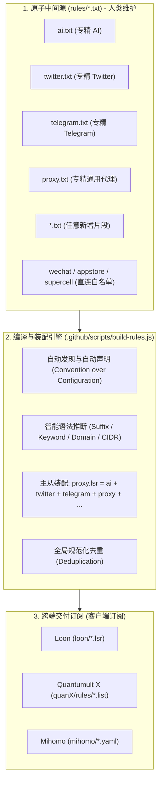

# 分流规则引擎工作原理与使用指南 (Ruleset Engine Guide)

本项目采用**“原子中间源 + 智能推断引擎 + 声明式自动装配”**的多平台规则管理架构。人类只需以最纯粹的纯文本维护 `rules/*.txt`，编译器会自动完成推断、去重、主从汇聚以及多平台分发。

---

## 1. 核心架构与工作原理



### 核心设计哲学
1. **单一真理来源 (Single Source of Truth, SSOT)**：
   - 任何域名只在一个源文件中存在，源文件之间**绝对零物理重复**，无任何侵入式机器标记。
2. **主从从属自动汇聚 (Master Aggregation)**：
   - `proxy` 作为全量兜底黑名单，编译时会自动在内存中汇聚所有非直连的代理片段（`ai.txt + twitter.txt + telegram.txt + proxy.txt + ...`），保证客户端订阅 `proxy.lsr` 永远具备 100% 完备覆盖。
3. **约定优于配置 (Convention over Configuration)**：
   - 在 `rules/` 下创建任何 `.txt` 文件，引擎会自动感知、自动声明并编译至三端，无需手动修改任何 JS 代码。
4. **直连白名单隔离 (Direct Isolation)**：
   - 标记为 `direct` 的白名单（如微信、应用商店、游戏）严格保持独立，绝不会混入全量代理黑名单。

---

## 2. 源文件书写规范 (`rules/*.txt`)

在源文件中无需记忆任何客户端专有语法，直接编写纯文本即可：

| 意图 | 编写格式 | 引擎自动推断为 | 示例 |
| :--- | :--- | :--- | :--- |
| **域名后缀匹配** (最常用) | 直接写主域名或带点域名 | `DOMAIN-SUFFIX` / `host-suffix` | `google.com`<br>`openai.com` |
| **关键词匹配** | 前缀 `keyword:` 或纯英文字词 | `DOMAIN-KEYWORD` / `host-keyword` | `keyword: twitter`<br>`discord` |
| **精准域名匹配** | 前缀 `exact:` 或 `full:` | `DOMAIN` / `host` | `exact: api.google.com` |
| **IPv4 网段** | 标准 CIDR 格式 | `IP-CIDR` / `ip-cidr` | `91.108.4.0/22` |
| **IPv6 网段** | 标准 IPv6 CIDR 格式 | `IP-CIDR6` / `ip-cidr6` | `2001:b28:f23d::/48` |
| **分类注释** | 井号开头，单单词极简英文 | 保留分类结构，消除杂质 | `# Infrastructure`<br>`# Search` |

> ⚠️ **注释规范 (Strictly English Only)**：
> 无论何时，所有 `rules/*.txt` 中的注释**严禁使用中文**，必须使用纯英文，且推荐**单单词极简概括**（如 `# Tools`、`# Models`），保持排版轻盈。

---

## 3. 日常维护使用说明

### 3.1 编辑已有规则片段 (99% 的场景)
直接用编辑器打开对应的 `.txt` 文件，在相应分类下回车新增或删除域名，保存即可：
- 修改 AI 规则 👉 编辑 [`rules/ai.txt`](ai.txt)
- 修改 Twitter 规则 👉 编辑 [`rules/twitter.txt`](twitter.txt)
- 修改 Telegram 规则 👉 编辑 [`rules/telegram.txt`](telegram.txt)
- 修改通用翻墙黑名单 👉 编辑 [`rules/proxy.txt`](proxy.txt)

**自动联动效果**：
在 `rules/twitter.txt` 里添加了新域名，编译时不仅 `twitter.lsr` 拥有该规则，全量 `proxy.lsr` 也**自动同步收录**，无需双重维护！

---

### 3.2 新增全新规则片段 (0 配置自动声明)

#### ① 新增走代理的专有片段 (如 `streaming`)
想为流媒体单独做一个规则走专有节点分流：
1. 直接在 `rules/` 目录下新建 `rules/streaming.txt`：
   ```ini
   # Streaming
   netflix.com
   disneyplus.com
   max.com
   ```
2. 保存文件。
3. **引擎自动处理**：
   - 自动生成 `loon/streaming.lsr`、`quanX/rules/streaming.list`、`mihomo/streaming.yaml`。
   - 自动将流媒体域名**合并汇聚进全量 `proxy.lsr`** 兜底。

#### ② 新增走直连的白名单片段 (如 `game`)
想新增一个国内游戏直连规则：
1. 新建 `rules/game.txt`，在**第一行注明 `# direct`**：
   ```ini
   # direct
   epicgames.com
   unrealengine.com
   ```
2. 保存文件。
3. **引擎自动处理**：
   - 识别为直连策略，生成各端直连规则集。
   - **绝对不会**混入全量代理 `proxy.lsr`。

---

### 3.3 编译与自动化工作流

#### 1. 本地热重载监听模式 (推荐)
在本地开发时，推荐挂起监听器：
```bash
node .github/scripts/build-rules.js --watch
```
你在编辑器中修改并保存任意 `rules/*.txt`（`Ctrl + S`），终端会在 **0.1 秒内自动完成重编译**并运行规范与沙盒校验。

#### 2. 命令行快速追加
不想手动找文件位置时，可用命令行一键追加：
```bash
# 追加到默认通用 proxy
node .github/scripts/build-rules.js --add example.com sub.org

# 追加到指定片段 (若片段不存在会自动新建并声明)
node .github/scripts/build-rules.js --add claude.ai --target ai

# 追加关键词
node .github/scripts/build-rules.js --add-keyword twitter --target twitter
```

#### 3. 云端持续集成 (GitHub Actions)
每次向远程分支推送 `rules/**` 的变更，GitHub Actions 会自动触发 `.github/workflows/build-rules.yml`：
- 在云端自动执行 `build-rules.js`；
- 自动格式化三端产物；
- 通过 `validate.js` 执行沙盒与语法规范测试；
- 将编译更新自动提交回写仓库，提交信息自动附带修改的模块名称 `[skip ci]`。
